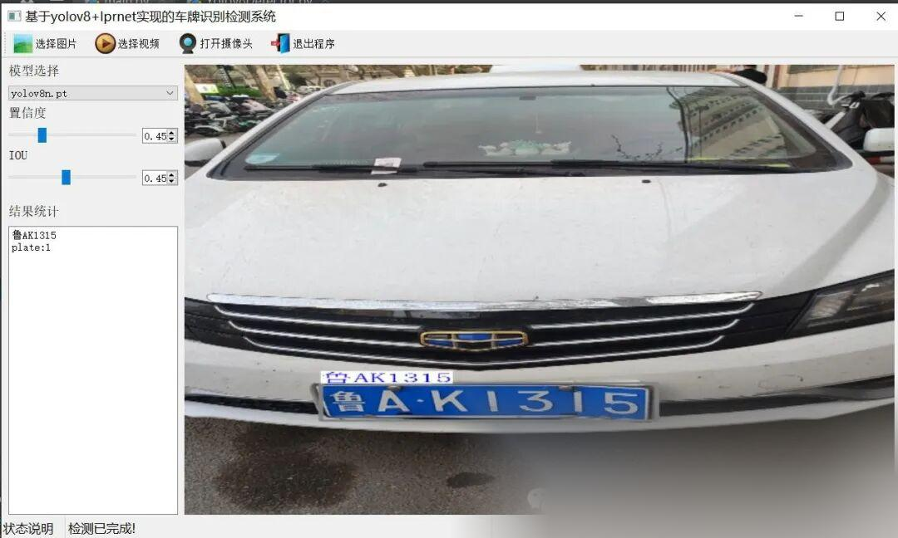
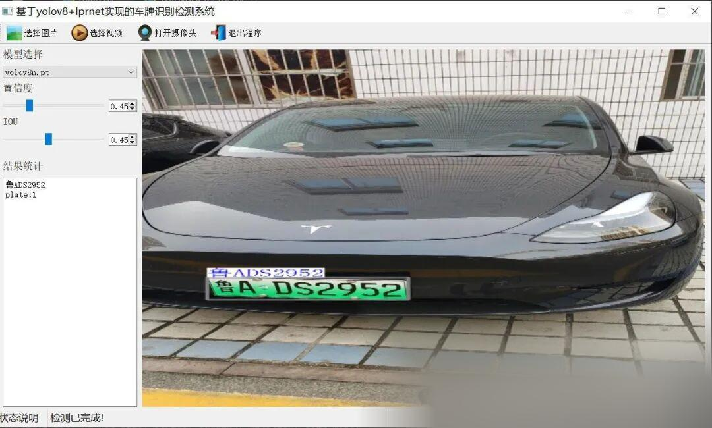

# Chinese License Plate Recognition System based on YOLOv8+LPRNet in Python Source Code + PyTorch Model + High-quality GUI Interface

[Algorithm Introduction]

A Chinese license plate recognition system based on YOLOv8 and LPRNet is an efficient and accurate solution that integrates advanced technologies in object detection and character recognition. YOLOv8, as the latest real-time object detection algorithm, is renowned for its high speed and precision, enabling rapid localization of license plates in images or videos. LPRNet, a deep learning network specifically designed for license plate character recognition, can accurately identify Chinese characters, letters, and numbers on license plates, performing exceptionally well even in complex scenarios.

The system first uses YOLOv8 to detect license plates in the input image. Fastly locate the license plate area. Subsequently, Input the detected license plate image into LPRNet for character recognition. Extract features through convolutional neural networks and map them to character categories. Implement automatic identification of license plate numbers. This combination method not only improves the accuracy of license plate recognition, It also ensures real-time performance. Applicable to traffic management. Intelligent parking Security surveillance and various other scenarios.

Furthermore, the system possesses robust data processing capabilities and scalability to handle license plate images under varying lighting conditions, angles, and occlusions. It enhances model generalization through data augmentation techniques. Additionally, the system supports detection from static images, video files, and real-time camera inputs, offering users flexible and diverse usage options. In summary, the Chinese license plate recognition system based on YOLOv8 and LPRNet is an efficient, accurate, and reliable solution for license plate identification.

[Effect Display]





[Test Environment]

windows10
anaconda3+python3.8
torch==1.9.0+cu111
ultralytics==8.2.95

The model can detect the category.

plate

[Related Recommended Datasets]

[Partial Implementation Source Code]

-
-
-
-
-
-
-
-
-
-
-
-
-
-
-
-
-
-
-
-
-
-
-
-
-
-
-
-
-
-
-
-
-
-
-
-
-
-
-
-
-
-
-
-
-
-
-
-
-
-
-
-
-
-
-
-
-
-
-
-
-
-
-
-
-
-
-
-
-
-
-
-
-
-
-
-
-
-
-
-
-
-
-
-
-
-
-
-
-
-
-
-
-
-
-
-
-
-
-
-
-
-
-
-
-
-
-
-

```
class Ui_MainWindow(QtWidgets.QMainWindow):    signal = QtCore.pyqtSignal(str, str)     def setupUi(self):        self.setObjectName("MainWindow")        self.resize(1280, 728)        self.centralwidget = QtWidgets.QWidget(self)        self.centralwidget.setObjectName("centralwidget")         self.weights_dir = './weights'         self.picture = QtWidgets.QLabel(self.centralwidget)        self.picture.setGeometry(QtCore.QRect(260, 10, 1010, 630))        self.picture.setStyleSheet("background:black")        self.picture.setObjectName("picture")        self.picture.setScaledContents(True)        self.label_2 = QtWidgets.QLabel(self.centralwidget)        self.label_2.setGeometry(QtCore.QRect(10, 10, 81, 21))        self.label_2.setObjectName("label_2")        self.cb_weights = QtWidgets.QComboBox(self.centralwidget)        self.cb_weights.setGeometry(QtCore.QRect(10, 40, 241, 21))        self.cb_weights.setObjectName("cb_weights")        self.cb_weights.currentIndexChanged.connect(self.cb_weights_changed)         self.label_3 = QtWidgets.QLabel(self.centralwidget)        self.label_3.setGeometry(QtCore.QRect(10, 70, 72, 21))        self.label_3.setObjectName("label_3")        self.hs_conf = QtWidgets.QSlider(self.centralwidget)        self.hs_conf.setGeometry(QtCore.QRect(10, 100, 181, 22))        self.hs_conf.setProperty("value", 25)        self.hs_conf.setOrientation(QtCore.Qt.Horizontal)        self.hs_conf.setObjectName("hs_conf")        self.hs_conf.valueChanged.connect(self.conf_change)        self.dsb_conf = QtWidgets.QDoubleSpinBox(self.centralwidget)        self.dsb_conf.setGeometry(QtCore.QRect(200, 100, 51, 22))        self.dsb_conf.setMaximum(1.0)        self.dsb_conf.setSingleStep(0.01)        self.dsb_conf.setProperty("value", 0.25)        self.dsb_conf.setObjectName("dsb_conf")        self.dsb_conf.valueChanged.connect(self.dsb_conf_change)        self.dsb_iou = QtWidgets.QDoubleSpinBox(self.centralwidget)        self.dsb_iou.setGeometry(QtCore.QRect(200, 160, 51, 22))        self.dsb_iou.setMaximum(1.0)        self.dsb_iou.setSingleStep(0.01)        self.dsb_iou.setProperty("value", 0.45)        self.dsb_iou.setObjectName("dsb_iou")        self.dsb_iou.valueChanged.connect(self.dsb_iou_change)        self.hs_iou = QtWidgets.QSlider(self.centralwidget)        self.hs_iou.setGeometry(QtCore.QRect(10, 160, 181, 22))        self.hs_iou.setProperty("value", 45)        self.hs_iou.setOrientation(QtCore.Qt.Horizontal)        self.hs_iou.setObjectName("hs_iou")        self.hs_iou.valueChanged.connect(self.iou_change)        self.label_4 = QtWidgets.QLabel(self.centralwidget)        self.label_4.setGeometry(QtCore.QRect(10, 130, 72, 21))        self.label_4.setObjectName("label_4")        self.label_5 = QtWidgets.QLabel(self.centralwidget)        self.label_5.setGeometry(QtCore.QRect(10, 210, 72, 21))        self.label_5.setObjectName("label_5")        self.le_res = QtWidgets.QTextEdit(self.centralwidget)        self.le_res.setGeometry(QtCore.QRect(10, 240, 241, 400))        self.le_res.setObjectName("le_res")        self.setCentralWidget(self.centralwidget)        self.menubar = QtWidgets.QMenuBar(self)        self.menubar.setGeometry(QtCore.QRect(0, 0, 1110, 30))        self.menubar.setObjectName("menubar")        self.setMenuBar(self.menubar)        self.statusbar = QtWidgets.QStatusBar(self)        self.statusbar.setObjectName("statusbar")        self.setStatusBar(self.statusbar)        self.toolBar = QtWidgets.QToolBar(self)        self.toolBar.setToolButtonStyle(QtCore.Qt.ToolButtonTextBesideIcon)        self.toolBar.setObjectName("toolBar")        self.addToolBar(QtCore.Qt.TopToolBarArea, self.toolBar)        self.actionopenpic = QtWidgets.QAction(self)        icon = QtGui.QIcon()        icon.addPixmap(QtGui.QPixmap(":/images/1.png"), QtGui.QIcon.Normal, QtGui.QIcon.Off)        self.actionopenpic.setIcon(icon)        self.actionopenpic.setObjectName("actionopenpic")        self.actionopenpic.triggered.connect(self.open_image)        self.action = QtWidgets.QAction(self)        icon1 = QtGui.QIcon()        icon1.addPixmap(QtGui.QPixmap(":/images/2.png"), QtGui.QIcon.Normal, QtGui.QIcon.Off)        self.action.setIcon(icon1)        self.action.setObjectName("action")        self.action.triggered.connect(self.open_video)        self.action_2 = QtWidgets.QAction(self)        icon2 = QtGui.QIcon()        icon2.addPixmap(QtGui.QPixmap(":/images/3.png"), QtGui.QIcon.Normal, QtGui.QIcon.Off)        self.action_2.setIcon(icon2)        self.action_2.setObjectName("action_2")        self.action_2.triggered.connect(self.open_camera)         self.actionexit = QtWidgets.QAction(self)        icon3 = QtGui.QIcon()        icon3.addPixmap(QtGui.QPixmap(":/images/4.png"), QtGui.QIcon.Normal, QtGui.QIcon.Off)        self.actionexit.setIcon(icon3)        self.actionexit.setObjectName("actionexit")        self.actionexit.triggered.connect(self.exit)         self.toolBar.addAction(self.actionopenpic)        self.toolBar.addAction(self.action)        self.toolBar.addAction(self.action_2)        self.toolBar.addAction(self.actionexit)         self.retranslateUi()        QtCore.QMetaObject.connectSlotsByName(self)        self.init_all()
```

```
[Usage Steps]

```

Usage Steps:
1. First, install the YOLOv8 environment according to the official framework https://github.com/ultralytics/ultralytics and PyQt5 installation tutorial.
2. After switching to your installed YOLOv8 environment, navigate to the source code directory and execute python main.py to start the interface for operation.

[Provided Files]

Python source code
yolov8n.pt model + lprnet license plate recognition model pt
Test images (under test_img folder)

[Video demonstration]

Based on YOLOv8 for Chinese license plate recognition system in Python source code + PyTorch model + exquisite GUI interface - Bilibili [Test environment] Windows 10 Anaconda 3+Python 3.8 torch==1.9.0+cu111ultralytics==8.2.95 [The model can detect categories]. For more implementation details or source code download, please refer to: https://blog.csdn.net/FL1623863129/article/details/142317812. Video views: 1, comments: 0, likes: 0, coins: 0.Collection number 0, forwarding number 0, video author Future Autonomous Research Center. Author's biography: Future Autonomous Research Center. Relevant videos: YOLOv8 detection interface - PyQt5 implementation, deployment of the tensorrt model for target detection using C# with Yolov8, fastest detection speed on WinForm based on YOLOv8 + DeepSort, video demonstration of target tracking using YOLOv8 + deepsort, pure OpenCvSharp deployment of YOLOv8-pose pose recognition in C#, deployment of the tensorrt model for target detection using C# with YOLOv8, algorithm results demonstration of winform version of YOLOv8-onnx + bytetrack target tracking based on C#.Implementing a real-time speech recognition project using Python with FunAssembly+PyAudio for local microphone input, and demonstrating the second interface of YOLOv8 detection with PyQt5. Utilizing Easy Language to deploy the ONNX model of YOLOv8, encapsulating YOLOv10 into a class for simple invocation to complete object detection tasks.

https://www.bilibili.com/video/BV1B5tYeSEyg/?vd_source=989ae2b903ea1b5acebbe2c4c4a635ee


## Payment

Here is a pay link on Stripe ( https://buy.stripe.com/3cs8yP7sY87d0vu9AB ). Please contact me lonlonago@foxmail.com after funding $89, and I will send you a complete data files , thank you!


